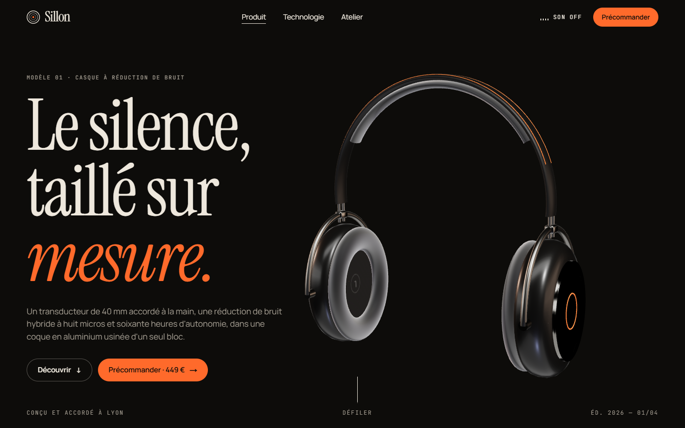
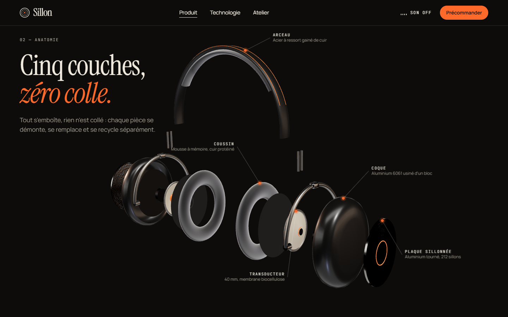
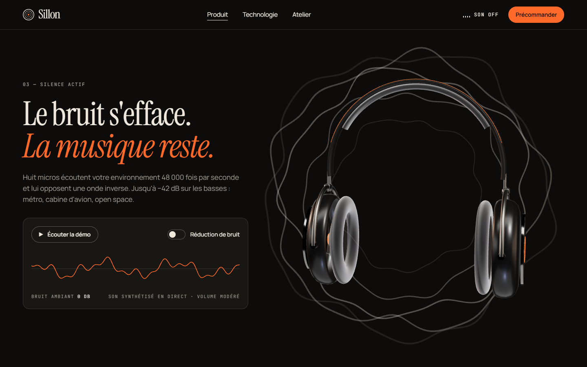
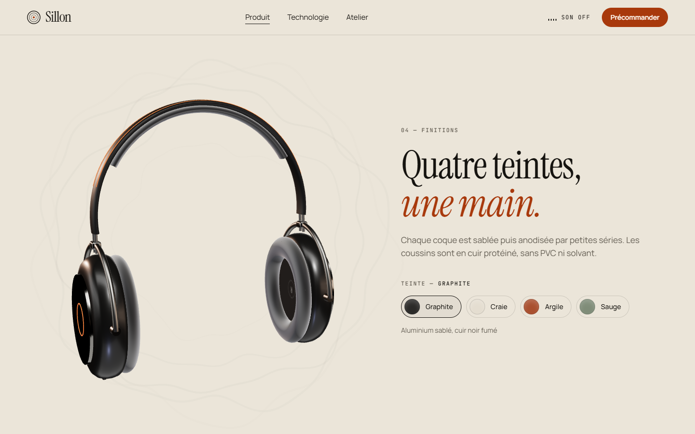
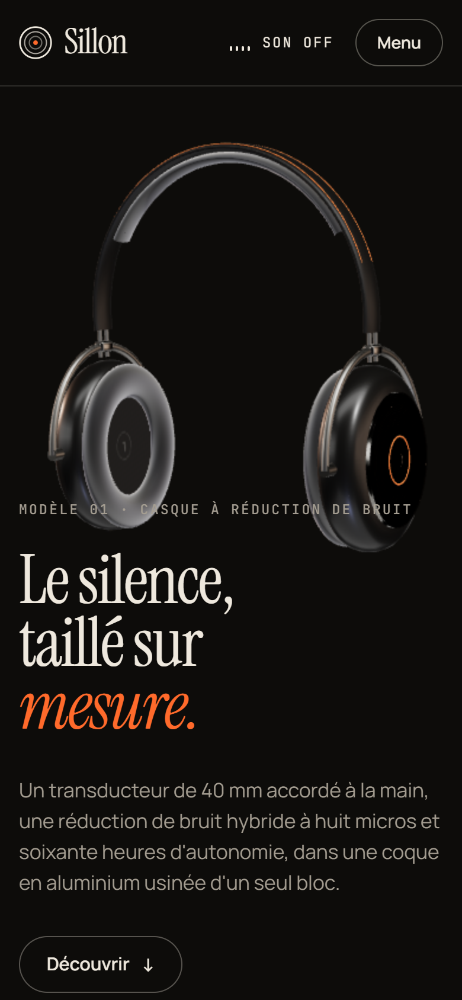

# Sillon — site vitrine 3D d'un casque audio

Site vitrine d'une **marque fictive** de casques à réduction de bruit, pensé comme un projet de portfolio front-end.
Le casque est **modélisé entièrement en code** (Three.js) : aucun modèle 3D, aucune image, aucun son n'est chargé.



| Vue éclatée pilotée par le scroll | Démo interactive de la réduction de bruit |
| --- | --- |
|  |  |
| **Quatre finitions, changement en direct** | **Mobile** |
|  |  |

## Ce que montre le projet

- **Scène 3D scénarisée au scroll.** Une seule scène WebGL persiste d'une page à l'autre. Chaque section décrit un
  état (position, rotation, vue éclatée, ondes), et la scène s'interpole entre ces états pendant le défilement.
- **Casque procédural.** Coques tournées (lathe), arceau en tube, coussins en tore, transducteur démontable, textures
  dessinées dans un canvas (sillons concentriques, tissage), matériaux physiques et éclairage de studio sans HDR externe.
- **Vue éclatée annotée.** Les pièces s'écartent au scroll, et des étiquettes DOM suivent leurs ancres 3D image par image.
- **Réduction de bruit jouable.** Une ambiance urbaine et un accord sont synthétisés en direct (Web Audio). Activer la
  réduction de bruit filtre l'ambiance, aplatit la forme d'onde et calme les ondes autour du casque.
- **Thème qui suit la lecture.** Le site passe du sombre au clair selon la section affichée.
- **Transitions de page** avec rideau, **préchargement court** qui suit le vrai chargement (polices et scène 3D), et sons
  d'interface synthétisés (coupés par défaut).

## Accessibilité et confort

- Le zoom n'est jamais bloqué.
- La préférence système « réduire les animations » est respectée. Un interrupteur sur le site permet aussi de la changer
  à la main : plus de scroll fluide, plus de préchargement, contenu affiché tout de suite.
- Lien d'évitement, repères de page, titres hiérarchisés, focus visible, onglets et interrupteurs utilisables au clavier,
  menu mobile qui rend le reste de la page inerte et se ferme avec Échap.
- La 3D reste décorative (`aria-hidden`) : tout le contenu existe en HTML, et les étiquettes de la vue éclatée sont
  aussi présentes sous forme de liste.
- Contrastes vérifiés dans les deux thèmes. Le site reste lisible sans JavaScript et sans WebGL.

## Stack

Next.js 16 (App Router, pages statiques) · React 19 · TypeScript · Tailwind CSS 4 · Three.js, React Three Fiber et drei ·
Lenis (scroll fluide) · Zustand · Web Audio API.

## Lancer le projet

```bash
npm install
npm run dev -- -p 3400
```

Puis ouvrir http://localhost:3400. Build de production :

```bash
npm run build
npm run start -- -p 3401
```

## Organisation

```
src/
  app/                 pages (accueil, technologie, atelier, précommande, 404)
  components/three/    scène 3D : casque, ondes, pilotage, projection des étiquettes
  components/shell/    en-tête, pied de page, préchargement, rideau, scroll, préférences
  components/ui/       blocs réutilisables : apparitions, démo audio, sélecteur de teinte…
  lib/scenes.ts        états de la scène pour chaque section
  lib/sound.ts         sons d'interface synthétisés
```

## Mentions

Sillon, ses produits, ses chiffres et son histoire sont inventés. Aucun produit n'est vendu, et le formulaire de
précommande n'envoie rien. Polices : Instrument Serif, Manrope et JetBrains Mono (licence SIL Open Font).
